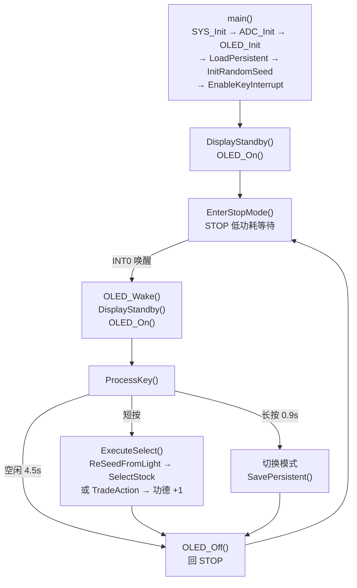

# LightStander 软件架构

> 在 8KB 的 Flash 里塞进 5914 支股票 — 这不是工程，是艺术。

## 总体流程



## 模块依赖

```
main.c
 ├── adc.c         ← ADC 初始化、光照读取
 ├── oled.c        ← SSD1306 驱动、字体渲染
 ├── keys.c        ← 按键中断、消抖、长按
 ├── modes.c       ← 选股/操盘执行逻辑
 │    ├── bitmap.h ← 12 组前缀位图
 │    └── random.c ← LCG 随机数
 ├── display.c     ← 界面显示函数
 ├── eeprom.c      ← 持久存储（双备份）
 └── stop.c        ← STOP 低功耗
```

## 随机数设计

### LCG 后处理

物理熵源提供种子后，使用线性同余生成器 (LCG) 进行后处理，扩展为均匀分布的随机序列：

```
state = state × 0x9D65 + 0x3B7B
output = state ^ (state >> 8)
```

增量必须是奇数。偶数增量会让状态最低位恒定，可达状态只剩 32768 个而不是 65536，等于把周期砍半——`0x3B7A` 就是这样，改成 `0x3B7B` 后才是满周期。每次按键只取一个值，这个周期远够用。

物理熵 + 数学变换的组合，兼顾了真正的随机性和均匀分布。

### 股票加权随机

12 个股票前缀按真实上市数量加权：

| 前缀 | 数量 | 说明 |
|------|------|------|
| 600 | 875 | 沪市主板 |
| 601 | 235 | 沪市主板 |
| 603 | 627 | 沪市主板 |
| 605 | 113 | 沪市主板 |
| 688 | 621 | 科创板 |
| 000 | 506 | 深市主板 |
| 001 | 122 | 深市主板 |
| 002 | 977 | 深市主板 |
| 003 | 42 | 深市主板 |
| 300 | 979 | 创业板 |
| 301 | 471 | 创业板 |
| 920 | 346 | 北交所 |
| **合计** | **5914** | |

### 位图压缩算法

**5914 支股票，全部压缩进 ~1.5KB Flash。**

传统方法需要存储 5914 个 16-bit 股票代码 = 11,828 字节。而位图压缩仅需 5914 bits；因每组前缀使用固定 125 字节数组，实际占用 1500 字节。

**压缩比：理论 16:1，实现约 8:1（11828 → 1501 字节）。**

算法原理：
- 每个股票前缀（如 600）对应一个位图数组
- 位图大小 = ⌈该前缀下最大股票后缀 / 8⌉ 字节，统一按 125 字节（后缀 000~999）
- 每个 bit 代表一支股票：1=存在，0=不存在
- 查询时：`byte_idx = suffix >> 3`，`bit_idx = suffix & 0x07`
- 一个字节一次查表，零分支，零循环

```c
// bitmap_600 覆盖后缀 000~999 → 125 字节
// bitmap_600[0] 的 bit0 = 600000 是否存在
// bitmap_600[0] 的 bit1 = 600001 是否存在
// ...
// bitmap_600[124] 的 bit7 = 600999 是否存在

#define BMP_HAS(bmp, n) (((bmp)[(n) >> 3] >> ((n) & 0x07)) & 0x01)
```

12 组位图覆盖全部 12 个股票前缀，查询速度 O(1)，代码量极小。

**这就是为什么 8KB 的 MCU 能装下整个 A 股市场。**

## 光熵随机数设计

LightStander 的核心设计理念是「以光为源」— 利用自然环境光作为随机数的物理熵源。
### 熵来源

光敏电阻（LDR）的阻值受光照强度影响而波动，这种波动包含大量不可预测的物理噪声：
- 光子到达的量子随机性
- 云层移动、树影摇曳等环境变化
- 人工光源的电磁干扰

ADC 采样这些波动并混入随机状态，使得每次开机、每次按下按钮的随机序列都不同。

### 种子生成

开机时采集 32 次 ADC 值，通过异或 + 循环移位混合生成种子：

```
for (i = 0; i < 32; i++) {
    seed ^= ReadLightADC();
    seed = (seed << 3) | (seed >> 13);  // rotate
}
```

每次选股前重新采集 8 次 ADC 混入状态（`ReSeedFromLight()`），确保每次按下按钮的随机性都包含最新的光照信息。

### 带隙基准的用处

STC8G1K08A 内置 1.19V 带隙基准，可以接到 ADC 的 CH15 通道采样。它的用途是反过来测电池电压：

```
VDD = 1.19 × 1023 / bandgap_reading
```

带隙读数本身与 VDD 无关（它是内部绝对基准），所以读数变大意味着 VDD 在往下掉。电池满电时读数约 369，对应 `1.19 × 1023 / 369 ≈ 3.30 V`。低电量保护就是看这个数：超过 `BAT_LOW_ADC`（420，约 2.9 V）就判定电量不足。

光照判断**不用**带隙补偿，原因见 [HARDWARE.md](HARDWARE.md#阈值)：强光下分压已饱和在 1023，补偿式退化成 $1023^2/\text{bg}$，阈值会跟着 bg 抖动，反而不稳。光照直接用原始读数判，饱和点本身就跟 VDD 无关。

注意这边的 ADC 是 **10 位**（0~1023），不是 12 位。用 4095 代入会算出 13.2 V 这种不可能的电压，很容易在这里绕进去。

## 低功耗设计

```
运行态 ──按键──> 唤醒 ──处理完──> STOP
  ↑                                │
  └────────── INT0 中断 ───────────┘
```

1. **进入 STOP**：等按键松开 → 关闭 ADC → 关 OLED 显示与电荷泵 → GPIO 设为准双向
2. **唤醒**：INT0 触发，MCU 从 STOP 恢复
3. **恢复顺序**：重新初始化 GPIO 与 ADC → `OLED_Wake()` 重发整表配置（保持关屏）→ 重画待机页 → `OLED_On()` 开屏

**睡眠期间用低电平触发，不是下降沿。** 这是修掉「黑屏、只能拔电重启」的关键。

原来的写法是 `IT0 = 1`（下降沿）入睡。这有两个坑：

- 如果按下按键那一刻就进 STOP，这个下降沿早就过去了，手一直按着也不会再有新的边沿，MCU 永远醒不来；
- 就算手已经松开，`ClearKeyPending()` 到 `PCON |= 0x02` 之间如果刚好来了一个下降沿，会先跳进中断，而中断服务里会关掉 `EX0`。等中断返回再执行 `PCON |= 0x02`，MCU 就带着 `EX0 = 0` 睡下去——这时它已经没有任何唤醒源了。

两种情况的结果一样：屏幕在进 STOP 前就被 `OLED_Off()` 关了，所以看起来就是黑屏，只能拔电池。改成低电平触发（`IT0 = 0`）后，只要手还按着就一直是唤醒条件，不再依赖「有没有那一个边沿」。醒来之后立刻切回下降沿，避免长按被当成连击。

入睡前还有一道守门：`WaitButtonRelease()` 等松手、`ClearKeyPending()` 清中断标志、再检查一次 `P32` —— 如果发现按键其实还是低，就不进 `STOP`。这条「没睡成」的路径同样要走完唤醒后的收尾流程（恢复配置 + 重画 + 开屏），不能直接 `return`：因为进 STOP 之前已经把 `ADC_CONTR` 清零、引脚也改回了休眠配置，跳过去的话之后每次读 ADC 都会超时返回 4096，低电量和弱光判断会静默失效。

醒来之后同样先等按键松开再走，避免刚醒就被自己的按键动作干扰。

低电量时不会直接返回主循环，而是显示一下电池图标再熄屏 `continue` 睡回去，所以电量不足时按按键不会反复点亮屏幕。

## 显示与 I2C

### 唤醒后为什么要重发整表配置

冷启动和唤醒共用同一张命令表 `oled_cfg[][2]`（`Sources/oled.c`），区别只在于冷启动多一段泄放等待和清显存。

早期版本的 `OLED_Wake()` 只补发几条命令，理由是「STOP 期间面板 VDD 一直挂着电池，内部状态不会丢」。这个假设只在短时间休眠下成立。电池电压偏低时，漏电流会把面板自己的复位电路慢慢拖到 POR 门限以下，面板就在睡眠期间悄悄复位了，寄存器全回出厂默认值。三种现象都能对上：

| 丢失的命令 | 出厂默认 | 现象 |
|---|---|---|
| `0xC8` COM 扫描方向 | `0xC0`（反向） | 画面上下颠倒 |
| `0x81` 对比度 `0xCF`、`0xD9` 预充 `0xF1` | `0x7F`、`0x22` | 颜色很淡 |
| `0xA8` 多路复用比 `0x1F`（32 路） | `0x3F`（64 路） | 多扫出的行 → 一行乱码 |

所以唤醒必须把整张表重发一遍。命令都是幂等的，重发只多花几十毫秒。

**更关键的是：面板复位时 GDDRAM 也会变成随机值。** 也就是说「睡前把待机页写进显存，醒来直接点亮」这条路根本靠不住——万一那块显存已经被清掉了，开屏瞬间就是一屏雪花。所以现在唤醒后的固定顺序是：

```
OLED_Wake()      重发整表配置，表头是 0xAE，全程关屏
  ↓
DisplayStandby() 在黑屏状态下重画待机页
  ↓
OLED_On()        发 0xAF 点亮
```

用户看到的第一帧就是完整画面，中间没有空白、没有雪花、没有「清空再出字」。同理，睡前那一遍写显存已经没必要了，`EnterStopMode()` 里只发 `OLED_Off()`。

`OLED_Init()` 也一样不在末尾发 `0xAF`，开屏统一交给调用方在画完之后做。早先的实现每轮末尾都开屏，GDDRAM 上电是随机内容，就会把雪花画出来，下一轮 `0xAE` 又关掉，几轮下来就是肉眼可见的闪几下。

### 命令表用 `[][2]` 而不是操作码 switch

`oled_cfg` 里每条是「命令 + 参数」两个字节，单字节命令的参数位填 `CFG_NA`。早先的写法是拿一个数组装命令、再靠 switch 判断「这条命令吃不吃参数」，新增一条双字节命令忘了改 switch，后面整串就会错位一个字节。用 `[][2]` 之后增删命令不会影响别的条目。

### I2C 可靠性

软件 I2C（P5.5=SCL, P5.4=SDA），引脚配置为开漏（`P5M0=0x30; P5M1=0x30`）。

**速率**：`I2C_Dly()` 循环 6 次得到 `tLOW≈1.5μs`，即 SCL≈330 kHz，在 SSD1306 的 400 kHz 上限内留有余量。不加延时时总线会跑到 1 MHz 左右，只在电压和上拉都恰到好处时才碰巧能工作。

**写数据不重试**：`I2C_WriteByte()` 会读 ACK 位，但不据此重发。SSD1306 在页寻址模式下写数据是纯流式的，多收一个字节就多占一列，整页右移，页尾溢出的那个字节回绕到列 0；初始化用了 `0xA1` 段重映射，列 0 正好在最右边，于是屏幕上会出现最右侧一条竖状乱码。ACK 只用来判断器件在不在线。

**命令也不单独重试**：SSD1306 有双字节命令（如 `0xD5 <arg>`），只重发首字节会让面板把下一条命令当成参数吞掉。要重试就重试整串。

**总线恢复**：`I2C_BusRecover()` 由主控把 SDA 保持在手，再打 20 个时钟，然后补一组 Start/Stop。面板卡在半个字节中间时会把 SDA 拉着不放，这时候主控不去驱动它，打再多时钟也放不开。冷启动和唤醒都先跑一遍。

**中断保护**：`OLED_Clear()` 刷 512 字节期间用 `EA=0/EA=1` 包住，避免被 INT0 打断。这是整个 I2C 层唯一需要禁中断的地方——一次性写 512 字节的时间足够长，被打断的代价是整页错位。

## EEPROM 存储

双槽交替 + 校验 + 序号，三重保证断电不丢数据、不读垃圾：

```
槽位格式 (7 B): chk | merit[4] | mode | seq
chk = merit[0]^merit[1]^merit[2]^merit[3]^mode^seq   ← 最先写入

写入: seq++ → seq 奇数写 B，偶数写 A（每次只擦一个扇区）
读取: 两槽都校验 chk
      都通过 → 取 (uint8_t)(seq_b - seq_a) < 0x80 的那个（序号更新者）
      只有一个通过 → 用它
      都不可信 → 默认值(merit=0, mode=STOCK)，且**不在启动路径写 EEPROM**
```

为什么需要校验字节：旧格式只有 `merit[4] + mode[1]`，唯一的合法性检查是 `mode<=1 && merit<=100000`。扇区擦除到一半掉电时，残留字节只要恰好落在范围内就会被认为是有效记录，表现为「这次开机 79、下次开机 101」。校验字节让任何半写、擦除残留、位翻转都被拒绝。

为什么需要序号：旧实现每次保存先擦 A 再擦 B，且启动时无条件优先 A。掉电发生在「A 已擦、B 未写」的瞬间，就会用半写过的 A 盖掉完好的 B。序号让启动时能判断哪个槽才是最新的。

为什么每次立即写：`save_pending` 只存在 RAM，攒够 10 次才写的话，攒的过程中断电会丢掉全部未写记录。改为每次按键立即写单槽后，断电最坏只丢一次；磨损上每个扇区每两笔才擦一次，按 10 万次擦写寿命折算约可支撑 20 万次按键。

启动不再擦写：旧实现在两槽都非法时直接在 `LoadPersistent()` 里调 `SavePersistent()`，在点亮屏幕之前连擦两个扇区还带重试，这就是开机后要黑屏一段时间的原因。现在只置待写标记，交给下一次 `FlushSave()`。

## Flash 布局

| 区域 | 大小 | 内容 |
|------|------|------|
| Code | 7669 B | 程序代码（Const/Font 已计入，Keil 报告的是最终链接体积） |
| Const | ~1.5 KB | 股票位图（bitmap.h） |
| Font | 864 B | 27×32 字模（font_cn_16.c） |
| ASCII Font | 60 B | 12×5 ASCII 字模（oled.c） |
| **总计** | **7669 B** | **上限 8192 B（余量 523 B ）** |